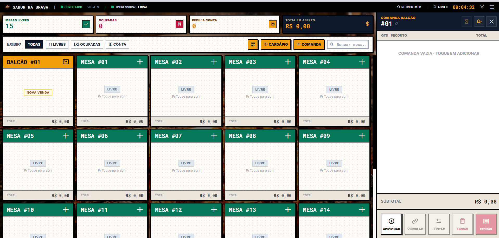

  

Sou estudante do ensino superior e desenvolvedor de software em formação. Gosto de criar aplicações que resolvam problemas práticos e de aprender construindo projetos — principalmente nas áreas de **dados, bancos de dados e desenvolvimento de sistemas**.

Uso o GitHub como vitrine dos meus principais projetos. A maioria nasceu de necessidades reais (ou de muita curiosidade) e está documentada aqui para demonstrar minha evolução técnica.

  
  

## 🚀 Projetos em destaque

### 🍽️ Sistema Web de Gestão e PDV para Restaurante

Sistema web completo para apoiar a operação e a gestão de um restaurante. O projeto conta com controle de caixas e mesas, comandas individuais, cadastro de produtos e adicionais, além de módulos financeiros (tesouraria, contas a pagar/receber) e uma tela de desempenho do negócio.

<!-- -->

---

### 📱 Aplicativo Mobile para Consulta e Atualização de Produtos

Aplicativo conectado a um banco de dados **MariaDB** por meio de uma **API própria** (acessada pela rede local). Desenvolvido para permitir a consulta e atualização ágil de informações de produtos, como preços e estoque, além de funcionalidades voltadas para o atendimento ao cliente. *(Projeto de uso interno, código não versionado no GitHub).*

<!-- -->

---

### 🎮 Protótipos de Jogos (Godot)
Exploração de lógica de programação, gerenciamento de estados e interação através do desenvolvimento de jogos avançados em **Godot** (projetos pessoais não finalizados, mas com forte aplicação de lógica de software).

## 🧰 Tecnologias e ferramentas

### Linguagens

  
  
  
  

### Bancos de Dados

  
  
  

### Ferramentas e Ambientes

  
  
  
  

## 📊 Estatísticas do GitHub

<table align="center" width="100%">
  <tr>
    <td align="center" width="50%">
      
    </td>
    <td align="center" width="50%">
      
    </td>
  </tr>
</table>

  

🇬🇧 English Technical Summary (Click to expand)

 

**About me:**
Higher education student and software developer in training. I enjoy building applications that solve practical problems, focusing on data, databases, and system development. 

**Featured Projects:**
- **Restaurant Management & POS System (Private):** Full web system featuring table control, cashier management, financial modules, and order taking. Built with a focus on operational efficiency.
- **Product Management Mobile App:** Android app connected to a MariaDB database via a custom API over a local network. Used for inventory and pricing updates.
- **Godot Game Prototypes:** Advanced personal projects focused on game logic, state management, and software architecture.

**Tech Stack:**
Java, Python, HTML, CSS, SQL (MySQL, MariaDB, SQLite).
Tools: VS Code, NetBeans, Android Studio, Godot.

*Note: I am fully capable of reading and understanding technical documentation in English.*

---

  <i>Sempre aprendendo e transformando ideias em projetos. 🙂</i>

